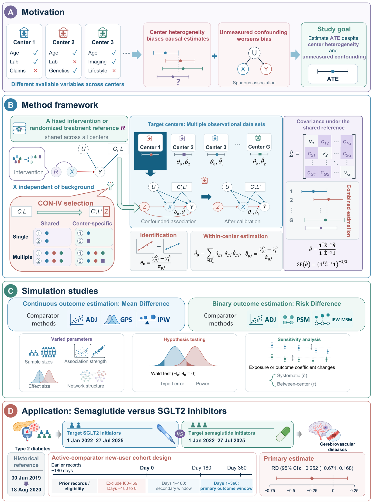

# Simulation codes in MCM-CONIV: A Multicenter Multiple Confounding Instrumental Variables Model

This repository contains the R code that produced the simulation results reported in

> A Multicenter Multiple Confounding Instrumental Variables Model for Controlling Unmeasured Confounding in Real-World Studies.
> Qingxin Luo, Yun Wei, Jialu Ma, Yuanyuan Yu, Fuzhong Xue.

The workflow of the model, the simulation studies, and the empirical application is shown below.



In multicenter real-world data, observed variables often differ across centers, and unmeasured confounding can further bias the estimated treatment effect. MCM-CONIV uses measured baseline covariates as confounding instrumental variables (CON-IV variables). In each target center, the outcome associations of the selected CON-IV variables are compared with those in a shared reference population with a fixed or randomized intervention; under partial transportability of these associations, the same average treatment effect is identified in every center without measuring the remaining confounders. Single or multiple CON-IV variables, in center-shared or center-specific sets, give four strategies. The center estimates are combined by feasible generalized least squares using their full covariance, including the covariance induced by the shared reference.

***Contents***

Each script is self-contained: it generates the data, selects the CON-IV variables, fits the four MCM-CONIV strategies and the comparator methods, and summarizes bias, empirical standard deviation, mean squared error, coverage, and rejection rates over `N_sim = 1000` replicates per scenario.

| Directory | Outcome | Simulations | Results in the article |
|---|---|---|---|
| `code-type1-estimate1/code` | Continuous | Strength of the exposure coefficients (`type1_beta_CX.R`), target center sample size (`type1_beta_OBS.R`), within-layer network correlation (`type1_beta_R_L.R`), network connection probability (`type1_beta_connection_prob.R`), correlation threshold for variable selection (`type1_beta_correlation_threshold.R`) | Appendix C.4 |
| `code-type1-estimate2/code` | Continuous | Treatment effect (`type1_beta_XY.R`), number of centers (`type1_Ncentre.R`), reference sample size (`type1_NRCT.R`), strength of the outcome coefficients (`type1_beta_CY.R`), correlation between C and U (`type1_UD_r0608.R`) | Fig. 3; Appendix C.4 |
| `code-type1-hy/code` | Continuous | Type I error (`type1_I_error_*.R`) and power at treatment effects 0.05 and 0.1 (`type1_power005_*.R`, `type1_power01_*.R`), varying the number of centers (`*_NC`) or the target center sample size (`*_NSS*`) | Fig. 4; Appendix C.4 |
| `code-type1-ses/code` | Continuous | Sensitivity analyses: a common multiplier δ (`type1_hetero_CX.R`, `type1_hetero_CY.R`, `type1_hetero_CX_CYboth.R`) or center-specific multipliers with log-scale standard deviation τ (`*_tua.R`) applied to the exposure coefficients, the background outcome coefficients, or both | Appendix C.4 |
| `code-type2-estimate1/code` | Binary | Latent-scale treatment coefficient (`type2_beta_XY.R`), exposure and outcome score strength (`type2_beta_CX.R`, `type2_beta_CY.R`), target center sample size (`type2_beta_Nall.R`), number of centers (`type2_beta_Ncentre.R`), reference sample size (`type2_beta_Nrct.R`) | Appendix C.5 |
| `code-type2-estiamte2/code` | Binary | Within-layer network correlation (`type2_beta_r_L.R`), network connection probability (`type2_beta_connection_prob.R`), correlation threshold for variable selection (`type2_beta_correlation_threshold.R`), unmeasured confounding strength (`type2_beta_U_strength.R`), correlation between C and U (`type2_beta_UD_r.R`) | Appendix C.5 |
| `code-type2-hy/code` | Binary | Type I error (`type2_Ierror_*.R`) and power at latent-scale coefficients 0.4, 0.5, and 0.8 (`type2_power_*_4.R`, `*_5.R`, `*_8.R`), varying the number of centers (`*_NC*`) or the target center sample size (`*_Nall*`) | Appendix C.5 |
| `code-type2-ses/code` | Binary | Sensitivity analyses with a common multiplier δ (`Sim_hetero_delta_*.R`) or center-specific multipliers τ (`Sim_hetero_tau_*.R`), and power at a latent-scale coefficient of 1 (`power_type2_*.R`) | Appendix C.5 |

The directory names follow the original archive. In the scripts, `type1` denotes continuous outcomes and `type2` binary outcomes; `IV_single_same`, `IV_single_diff`, `IV_multi_same`, and `IV_multi_diff` are the single-variable center-shared, single-variable center-specific, multiple-variable center-shared, and multiple-variable center-specific strategies.

***Requirements***

R with the packages `MASS`, `Matrix`, `metafor`, and `sandwich`. The package `RhpcBLASctl` is optional and, if installed, limits the number of BLAS threads (`n_threads` at the top of each script).

```r
install.packages(c("MASS", "Matrix", "metafor", "sandwich", "RhpcBLASctl"))
```

***Usage***

Run a script from the repository root, for example

```
Rscript code-type1-estimate2/code/type1_beta_XY.R
```

The summaries of all scenarios are written to `results/` in the working directory. The number of replicates (`N_sim`) and the scenario grid are set near the end of each script.

***Related resources***

The R package `coniv`, which implements the four MCM-CONIV strategies for user-supplied target-center and reference data, is available at https://github.com/QingxinLuo-SDU/coniv-toolkit. The code for the empirical application is available from the corresponding authors on reasonable request, because the application data are protected by privacy agreements.

***Citation***

Qingxin Luo, Yun Wei, Jialu Ma, Yuanyuan Yu, Fuzhong Xue. A Multicenter Multiple Confounding Instrumental Variables Model for Controlling Unmeasured Confounding in Real-World Studies. Manuscript submitted for publication.

***Development***

This code is developed by Qingxin Luo and Yuanyuan Yu. Please contact luoqingxin@mail.sdu.edu.cn for any questions.
